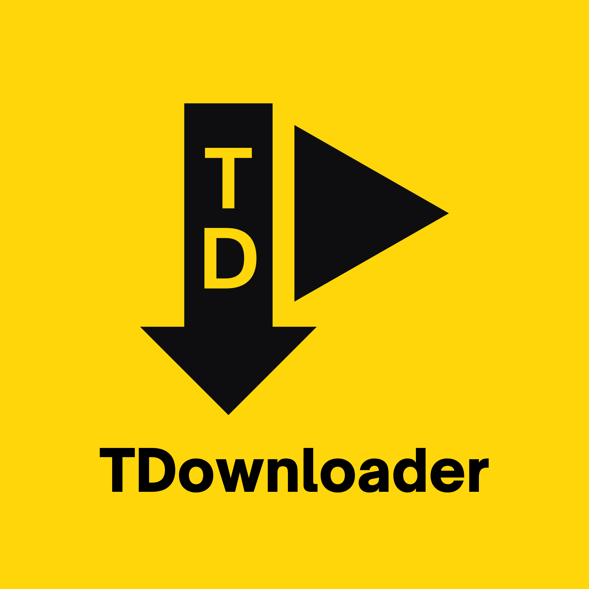

<p align="center">
  
</p>

# TDownloader

A fast, minimal Android app for downloading videos and images from Instagram, YouTube, and TikTok — directly to your gallery. No ads, no accounts, no servers.

Share a link from any app → pick quality → done.

<br>

## Features

- **Share sheet integration** — share any link from Instagram, YouTube, or TikTok and TDownloader appears instantly
- **Instagram image & carousel support** — multi-image Instagram posts download in full, not just the first item
- **Quality selector** — choose Best, 1080p, 720p, 480p, or Audio only before every download
- **Live progress modal + notification** — a circular progress indicator with live percentage, plus a persistent notification showing speed, MB downloaded, and ETA; tap "Do it in background" anytime and the download keeps running
- **In-app login** — built-in desktop browser for Instagram/TikTok authentication, no PC required
- **Download history with thumbnails** — real previews for every past download, and files removed outside the app are automatically marked "Deleted"
- **Auto-updating yt-dlp** — extractors update silently on every launch so platforms never break
- **Dark UI** — yellow-accented dark theme, edge-to-edge, with real platform icons on every tab

<br>

## Supported Platforms

| Platform | Public Videos | Private / Login Required |
|---|---|---|
| YouTube | ✅ No login needed | — |
| Instagram | ❌ Login required | ✅ via session ID (videos, images, and carousels) |
| TikTok | ✅ No login needed | ✅ via session ID |
| WhatsApp Status Saver | 🚧 Coming soon | — |
| Facebook | 🚧 Coming soon | — |

<br>

## Screenshots

> Coming soon

<br>

## Download

Get the latest APK from the [Releases](https://github.com/IamTalha-Sajid/tdownloader/releases) page.

### Install
1. Download the latest `tdownloader-vX.Y.Z.apk`
2. On your phone: **Settings → Apps → Special app access → Install unknown apps** → allow your browser or Files app
3. Open the downloaded APK and tap **Install**

<br>

## Instagram Login Setup

Instagram requires authentication for all downloads. TDownloader makes this easy:

**Option A — In-app browser (no PC needed)**
1. Open TDownloader → Instagram tab → **Login**
2. Tap **"Open browser & log in"**
3. Log into Instagram in the desktop browser that opens
4. Tap **"I'm logged in ✓"** — done

**Option B — Paste session ID (from PC)**
1. Open `instagram.com` in Chrome on your PC and log in
2. Press `F12` → **Application** → **Cookies** → `https://www.instagram.com`
3. Find `sessionid`, copy its value
4. Paste it in TDownloader → Instagram tab → Login → Save

<br>

## Tech Stack

| Concern | Choice |
|---|---|
| Language | Kotlin |
| UI | Jetpack Compose + Material 3 |
| Downloader | [youtubedl-android](https://github.com/yausername/youtubedl-android) (yt-dlp + Python + FFmpeg bundled), with [gallery-dl](https://github.com/mikf/gallery-dl) as a fallback for Instagram image/carousel posts |
| Min SDK | Android 8.0 (API 26) |
| Async | Kotlin Coroutines |
| Storage | DataStore (download history) |

<br>

## Building from Source

### Prerequisites
- Android Studio Hedgehog or newer
- JDK 11+
- Android SDK with API 35

### Steps

```bash
git clone https://github.com/IamTalha-Sajid/tdownloader.git
cd tdownloader
```

Open the project in Android Studio → let Gradle sync → hit **Run**.

To build a release APK:
```
Build → Generate Signed Bundle / APK → APK → release
```

<br>

## How It Works

TDownloader bundles Python, yt-dlp, gallery-dl, and FFmpeg inside the APK — no external dependencies, no internet servers, everything runs on-device.

When you share a link:
1. `ShareActivity` (translucent) extracts the URL and shows a quality picker
2. `DownloadService` (foreground service) runs yt-dlp with your chosen format. For Instagram posts with image slides — where yt-dlp's extractor can't handle mixed image/video carousels — it automatically falls back to gallery-dl
3. Progress is streamed to both a persistent notification and an in-app progress modal, with speed + ETA
4. On completion, every produced file is registered with MediaStore so it appears in your gallery instantly
5. A tappable notification opens the file directly

<br>

## Why ~200 MB APK?

The APK bundles a full Python runtime + FFmpeg + gallery-dl so yt-dlp works with zero setup on the phone, across every supported ABI. Breakdown:

| Component | Size |
|---|---|
| Python runtime | ~80 MB |
| FFmpeg | ~60 MB |
| yt-dlp + gallery-dl + app code | ~25 MB |
| Native libs (arm, arm64, x86, x86_64) | ~40 MB |

This is a one-time download. yt-dlp updates happen over the network at runtime (small delta, not a full APK update).

<br>

## License

This project is licensed under the **GPL-3.0 License** — inherited from [youtubedl-android](https://github.com/yausername/youtubedl-android).

See [LICENSE](LICENSE) for details.

<br>

## Disclaimer

This app is for **personal use only**. Downloading copyrighted content may violate the terms of service of the respective platforms. The developer is not responsible for misuse.

<br>

---

<p align="center">Built with ❤️ by <a href="https://github.com/IamTalha-Sajid">Talha Sajid</a></p>
